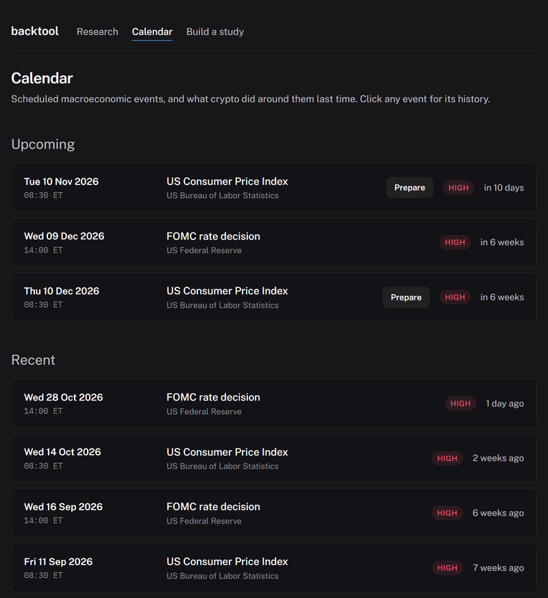
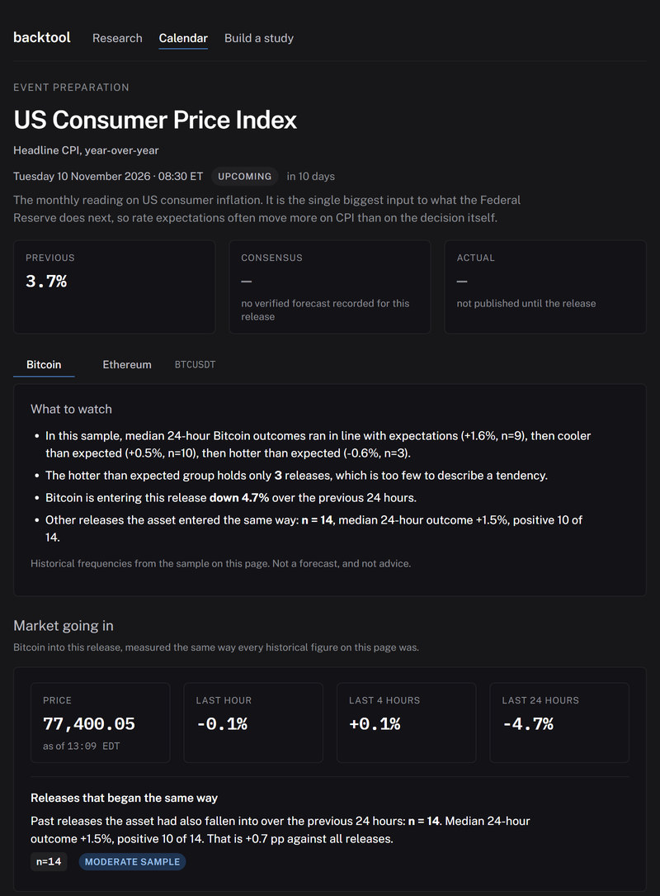
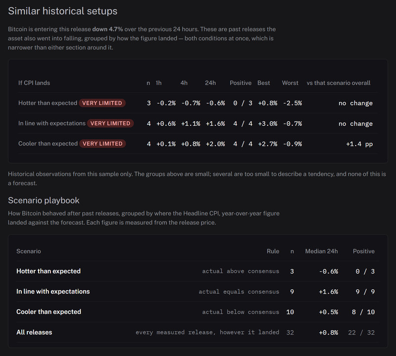
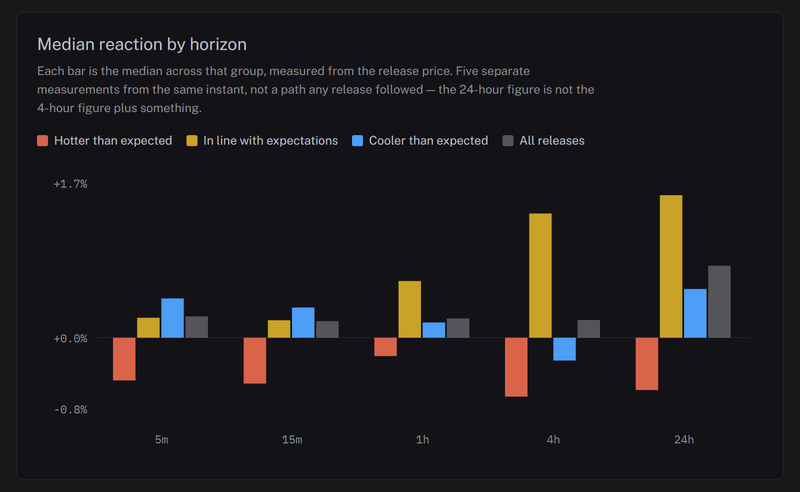

# Backtool — Macroeconomic Event Research & Backtesting Platform

Backtool helps traders and researchers prepare for upcoming macroeconomic
events by analysing how markets reacted to past ones. It answers questions
like *what has BTC done after a cooler-than-expected CPI print, and how does
today's setup compare with the days those prints landed on?*

Three things it does:

- **Event preparation** — open the next CPI release and see what each way it
  could land has historically meant, alongside the market conditions going
  into it.
- **Historical backtesting** — measure reactions across horizons from five
  minutes to two years, split by scenario, with every observation inspectable.
- **AI-assisted research** — ask a question in plain language. A model turns it
  into an explicit specification and explains the result; the deterministic
  engine computes every number in between.

The engine is the product. The model is a translator at each end of it, and is
structurally prevented from touching market data.

---

## Preview

**Macroeconomic calendar** — upcoming and recent FOMC and CPI releases, with
preparation available on releases that have not happened yet.



**CPI event preparation** — the published figures, a deterministic summary, and
the market going into the release.



**Scenario analysis** — each CPI outcome, and those same outcomes narrowed to
releases the asset entered the same way as today.



---

## Key features

| Feature | What it does |
| --- | --- |
| Event preparation | Published figures, current market context, scenario playbook and the releases behind every statistic — for the next CPI release |
| Scenario cohorts | Splits history into hotter / in-line / cooler prints against a verified consensus, with an all-releases baseline |
| Intersection cohorts | Narrows each scenario to releases the asset *entered the same way* as today — both conditions at once |
| Multi-horizon measurement | 5m, 15m, 1h, 4h, 24h for reactions; 7d to 2y for longer studies |
| Conversational research | Natural-language questions become explicit specifications, shown for confirmation before anything runs |
| Dynamic event resolution | Events outside the curated calendars resolved by search, with claim-level source provenance |
| Reproducible reports | Self-contained HTML with assumptions and a specification fingerprint |
| Automated data refresh | CPI actual and previous figures pulled from the BLS published series |

Supported today: **BTCUSDT and ETHUSDT**, **FOMC and CPI**, candle intervals
**5m / 15m / 1h**. Charts offer a 4h view as well, aggregated from hourly
candles for drawing only: the data layer stops at an hour because anything
coarser cannot resolve the 1-hour post-event window the product reports.

---

## How it works — a CPI release, end to end

**1. The calendar offers preparation on the next release.** Past releases link
to their event page instead; you cannot prepare for something that has printed.

**2. The page loads with no model call.** CPI is a curated calendar with a
hand-verified values file, so opening the page costs nothing. It shows:

```
PREVIOUS   3.7%
CONSENSUS  —      no verified forecast recorded for this release
ACTUAL     —      not published until the release
```

Each absence states which kind it is. A forecast nobody has published and one
this dataset has not collected are different facts, and are not both rendered
as a bare dash.

**3. Scenarios are computed from history.** Every past release with a verified
consensus is sorted by comparing actual against forecast, then measured at five
horizons from the release instant:



Grouped bars rather than a line, because these are five independent
measurements from one anchor — the 24-hour figure is not the 4-hour figure plus
something, and a line between them would draw a path no release followed.

**4. Today is matched against comparable setups.** The scenarios are narrowed
to releases the asset entered the same way, by a window that *ends at the
release* — so membership is fixed by what was knowable beforehand.

**5. After the print, the same page reports the outcome** horizon by horizon,
and withholds any window that has not closed. Four hours in, the 24-hour row
reads `closes in 20 hours` rather than a number.

---

## Technology stack

| Layer | Choice |
| --- | --- |
| Language | Python 3.12 (type-annotated, `mypy --strict`) |
| Analysis | pandas, NumPy |
| Validation | Pydantic v2 |
| Web | FastAPI, server-rendered HTML, TradingView Lightweight Charts |
| Storage | SQLite (standard library) |
| HTTP | httpx |
| Data | Binance public market data, BLS public API |
| AI | Anthropic Messages API over HTTP |
| Tooling | pytest, ruff, mypy |

No build step for the front end, no Docker, and no compiled dependencies
beyond the scientific stack.

---

## Architecture and engineering highlights

Dependencies point in one direction only:

```
core/        pure logic, zero I/O   (UTC standard, DST conversion, shared types)
   ↑
data/  events/     the I/O boundary (Binance client, SQLite cache, calendars,
   ↑                                 BLS release figures)
research/    specification → windows → per-event metrics → aggregation → cohorts
   ↑
reporting/   tables and charts
   ↑
web/  cli/   FastAPI app and command line
   ↑
ai/          planner, event resolver, interpreters
```

**The AI layer cannot reach market data.** `backtool.ai` may never import
`backtool.data`. The model emits specifications and consumes computed results,
so no code path exists from a model response to a price series — it cannot
fabricate a number that looks like one. Enforced by
[`test_ai_boundary.py`](tests/unit/test_ai_boundary.py), which checks the
import graph statically (AST) and at runtime. It has caught two real
violations.

**No look-ahead bias.** An event's anchor is the last candle close *at or
before* the announcement; the obvious alternatives leak post-event prices into
pre-event windows. Cohort conditions use windows that end at the release, and
the tests assert it as a property rather than an example — every outcome's sign
is flipped and membership must not move. See
[ADR 002](docs/decisions/002-event-anchoring.md).

**Reproducible by construction.** Every study carries its specification and a
fingerprint, so a set of numbers traces back to the question that produced it.
Pin `--as-of` and a run is repeatable as the calendar grows.

**Time handled once, at the edges.** Events are stored as local wall-clock time
plus an IANA zone; UTC is derived. 2 PM ET is 19:00 UTC in winter and 18:00 in
summer, and getting it wrong shifts every window by an hour while looking
completely fine. See [ADR 003](docs/decisions/003-utc-internal-time-standard.md).

**A statistic is computed once.** The browser is given a high; it never
recomputes one. Two definitions of a number is one definition too many.

**Absence is reported, never defaulted.** An unmeasurable window is not zero, a
missing consensus is not "in line", and an unpublished figure is not a gap in
the dataset.

Further decisions: [candle storage](docs/decisions/001-candle-storage.md) ·
[SQLite over Parquet](docs/decisions/004-sqlite-over-parquet.md) ·
[Anthropic over HTTP](docs/decisions/005-anthropic-over-http.md)

---

## Installation

Requires Python 3.11 or newer.

```bash
git clone https://github.com/itsKura/backtool.git
cd backtool
python -m venv .venv
```

Activate the environment — Windows PowerShell:

```bash
.\.venv\Scripts\Activate.ps1
```

macOS or Linux:

```bash
source .venv/bin/activate
```

Install with the development extras and copy the example configuration:

```bash
pip install -e ".[dev]"
```

```bash
cp .env.example .env
```

**No API key is required.** Binance's market-data endpoints and the BLS series
are both public; every page except the conversational research view works
without a model. Set `ANTHROPIC_API_KEY` in `.env` to enable that view.

> `api.binance.com` returns HTTP 451 in some jurisdictions, so the default base
> URL is `https://data-api.binance.vision` — Binance's public market-data
> mirror, serving the identical `/api/v3/klines` contract. Override with
> `BINANCE_BASE_URL` if you need a different host.

## Usage

Start the web interface:

```bash
backtool serve
```

Then open <http://127.0.0.1:8000>.

| Page | What it is |
| --- | --- |
| `/` | Calendar of upcoming and recent releases |
| `/event/{id}/prepare` | Event preparation and scenario analysis |
| `/event/{id}` | One event: what it is, its figures, and history around it |
| `/research` | Ask a research question in plain language |
| `/study` | Set a specification by hand |

From the command line:

```bash
backtool events -n 25
```

```bash
backtool analyse -n 20 --interval 5m --as-of 2026-09-18 --html reports/fomc-20.html
```

```bash
backtool analyse --ask "How does BTC behave in the hour after FOMC?" --html reports/ask.html --open
```

```bash
backtool refresh-cpi
```

`refresh-cpi` reports what it would change; pass `--write` to apply it. Run
`backtool --help` for the full set.

---

## Testing and reliability

```bash
pytest
```

**1,825 tests**, two skipped by default: one date-conditional, and the live
planner suite, which spends real money and is opt-in.

```bash
pytest -m "not network"     # offline only
ruff check . && mypy        # lint and strict type-check
```

Correctness of financial calculation comes before everything else — a polished
interface over wrong arithmetic is worth less than nothing, because it is
convincing. Tests concentrate on invariants whose violation would be
*invisible*:

- DST conversion pinned against real FOMC dates on both sides of both
  changeovers, plus non-existent and ambiguous wall-clock times
- Cohort membership must not move when every outcome's sign is flipped
- Windows that have not closed stay unpriced rather than becoming zero
- A release is excluded from the comparison group explaining it
- The AI import boundary, statically and at runtime
- Recorded planner answers, so prompt changes surface as diffs

---

## Data sources and limitations

| Source | Coverage |
| --- | --- |
| FOMC calendar | 81 meetings, 2017–2026, verified row by row against the Federal Reserve's published calendar |
| CPI calendar | 34 releases, 2024–2026 |
| CPI figures | Previous and actual from the BLS series `CUUR0000SA0`; consensus hand-transcribed with a cited source per row |
| Market data | Binance BTCUSDT / ETHUSDT, 5m / 15m / 1h, cached in SQLite |

The CPI measure is **headline CPI-U, all items, year-over-year, not seasonally
adjusted**. Core CPI and month-over-month are different series and are not in
this dataset. Full provenance and deliberate exclusions:
[docs/data-sources.md](docs/data-sources.md).

**Known limits**

- **Consensus forecasts have no free source.** They are surveys sold by
  Bloomberg, Reuters and Dow Jones. `refresh-cpi` fills previous and actual
  automatically; consensus stays hand-transcribed, and a release without one is
  excluded from the scenario cohorts rather than counted as in line.
- Scenario samples are small — 3 to 10 releases per CPI outcome. Every cohort
  shows its count and a quality band. No significance claim is made anywhere,
  because none is computed.
- BTCUSDT on Binance begins 2017-08-17. Earlier events are reported as
  `insufficient_data`, never silently dropped.
- The CPI calendar covers 2024 onwards; earlier BLS archives were unreachable,
  and dates are omitted rather than reconstructed.
- The 2025 US government shutdown delayed three CPI releases and cancelled one
  entirely; October 2025 was never published.
- The March 2020 FOMC meeting was cancelled and replaced by an unscheduled
  Sunday action, so 2020 has seven scheduled meetings.

---

## Roadmap

| Milestone | Scope | Status |
| --- | --- | --- |
| 1 | UTC time standard, DST conversion, FOMC calendar, window metrics | ✅ |
| 2 | Binance client, SQLite cache, gap detection, many events | ✅ |
| 3 | Cross-event aggregation, charts, HTML report | ✅ |
| 4 | AI planner and interpreter | ✅ |
| 5 | Web interface: calendar, event pages, scenario and setup cohorts | ✅ |
| 6 | Conversational research, dynamic event resolution, long horizons | ✅ |
| 7 | CPI event preparation, intersection cohorts, BLS integration | ✅ |
| 8 | FOMC preparation, more assets, funding and open-interest data | Planned |

Exploratory pattern discovery is deliberately last: it needs careful handling
of multiple-hypothesis testing before it is trustworthy.

## Licence

[MIT](LICENSE).
